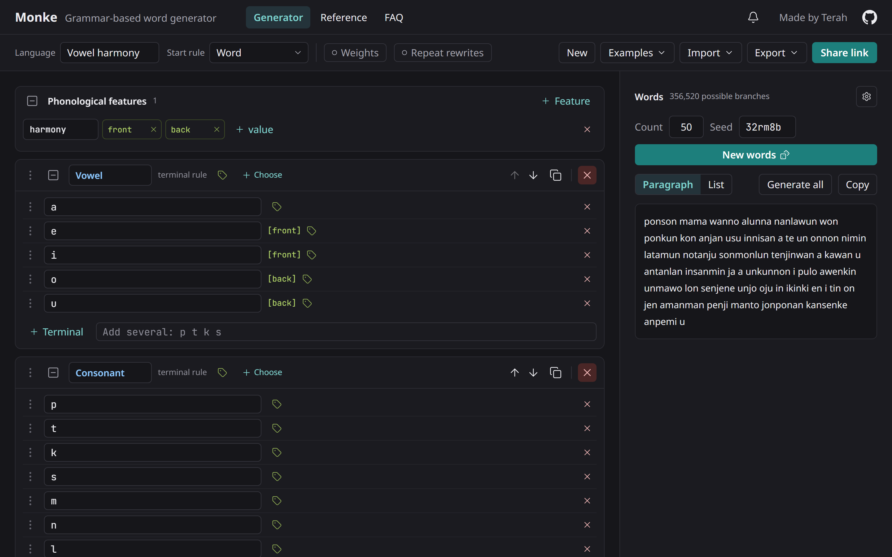

# Monke

**A free, grammar-based word generator for conlangs.** Describe the sound patterns of your language with rules and
generate as many words as you need. It runs entirely in your browser: no account, and your grammar lives in the link.

**[Open Monke →](https://monke.lunah.dev/)** · [Reference](https://monke.lunah.dev/reference/) · [FAQ](https://monke.lunah.dev/faq/) · [Coming from Awkwords](https://monke.lunah.dev/awkwords-alternative/)



## A taste of the syntax

```
C    terminals: p t k s m n
V    terminals: a e i o u
Word pattern:   [C.V]{1:3}.('n'*0.3)     →  ka, tosin, kumane, …
```

Rules combine quoted text, other rules, `.` sequences, `/` choices, `*N` weights, `(x)` optionals and `{min:max}`
repetition. Rewrites (with back-references) model sound changes, and exclusions reject what you don't want.

## Features

**Grammar**
- Named rules from terminals (a sound inventory) or patterns: sequences, choices, optionals, groups and repetition
- Probability weights on choices, optionals and terminals
- Rewrites to model sound changes, with back-references (`#0#`) and word boundaries (`^`, `$`)
- Exclusions that reject any output containing a pattern, e.g. `C.#0#` bans doubled consonants
- Phonological features for vowel harmony and consistent branching: tag items `[front]`/`[back]`, let a rule choose a
  value for everything inside it, or filter references with `Vowel<front>` and `Vowel<!back>`

**Generating**
- Words update as you edit, from a seed you can set and share; **New words** draws a fresh set
- **Generate all** lists every distinct word a grammar can make (up to 10,000)
- Clear errors under the field at fault, with hints like "Did you mean `Vowel`?"

**Sharing and files**
- Share links hold the whole grammar; nothing is stored on a server
- Browser Back and Forward undo and redo your edits
- Export and import `.monke` files; import Awkwords patterns and `.awkw` files
- Example grammars and tested recipes in the Examples menu

**For everyone**
- Works on phones and desktops
- Full keyboard support, including reordering without dragging; screen reader announcements; WCAG AA contrast

See [what's new](https://monke.lunah.dev/news/) for the latest changes.

## Development

```
npm install
npm run dev      # Vite dev server
npm test         # Vitest
npm run build    # type-check, build, prerender the static pages
```

See [AGENTS.md](./AGENTS.md) for the architecture.
